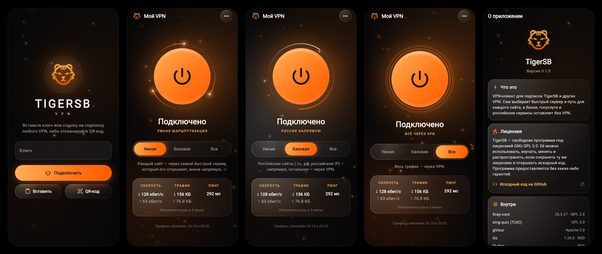

<p align="center">
  
</p>

<p align="center">
  <a href="https://github.com/Stilltiger45/TigerSB-client/releases/tag/V0.1"></a>
  <a href="LICENSE"></a>
  
  
</p>

<p align="center">
  <a href="https://github.com/XTLS/Xray-core"></a>
  <a href="https://github.com/SagerNet/sing-quic"></a>
  <a href="https://gvisor.dev"></a>
</p>

<p align="center">
  
  
  
  
</p>

<p align="center">
  <a href="README.ru.md">🇷🇺 Русский</a> &nbsp;|&nbsp; 🇬🇧 <b>English</b>
</p>

---

**TigerSB** is a VPN app with nothing to set up: paste a key and you are connected. It picks the fastest server by itself, decides which sites go through the VPN and which go direct, and keeps the connection up when the network changes. It works with its own panel, [TigerSB-panel](https://github.com/Stilltiger45/TigerSB-panel), and with subscriptions from other VPNs (Marzban, 3x-ui, Remnawave and others), including Clash (YAML) and sing-box (JSON) configs, and with WireGuard and AmneziaWG.

<p align="center">
  
</p>

<sub>The app interface is in Russian.</sub>

**Contents:** [For users](#for-users) · [For developers](#for-developers)

# For users

## Quick start

1. **Download the app:**
   - Android 7+: [TigerSB-android.apk](https://github.com/Stilltiger45/TigerSB-client/releases/latest/download/TigerSB-android.apk). For old 32-bit phones: [TigerSB-android-old-phones.apk](https://github.com/Stilltiger45/TigerSB-client/releases/latest/download/TigerSB-android-old-phones.apk).
   - Windows 10 and 11: [TigerSB-windows-x64.exe](https://github.com/Stilltiger45/TigerSB-client/releases/latest/download/TigerSB-windows-x64.exe) for ordinary Intel and AMD computers, [TigerSB-windows-arm64.exe](https://github.com/Stilltiger45/TigerSB-client/releases/latest/download/TigerSB-windows-arm64.exe) for ARM computers (Snapdragon, for example).
2. **Install it:** on the phone open the file and allow the install; on the computer run the installer.
3. **Add a key** in any of these ways:
   - open a `tigersb://…` link from Telegram, email or the panel, and the app opens with the key already filled in;
   - scan a QR code (on the phone);
   - paste the key by hand: `tigersb://`, an `https://` subscription link, or `vless://`, `vmess://`, `trojan://`, `ss://`, `hysteria2://`, `tuic://`, `mierus://`, `mieru://`, `naive+https://`, `naive+quic://`, `wireguard://` links, an Amnezia `vpn://` key or the text of a WireGuard / AmneziaWG config (`.conf`).
4. **Press the connect button.** That's it.

The key comes from whoever runs the server: in [TigerSB-panel](https://github.com/Stilltiger45/TigerSB-panel) it is on the Users tab. The app updates itself: menu on the right → «Проверить обновление» (Check for update).

On Windows a system service holds the VPN, so it keeps working with the window closed. Menu «⋮» → «Настройки запуска» (Startup settings) starts the app with Windows: open, minimized, or with no window at all (the VPN comes back on by itself). If the VPN was on, it comes back on after a reboot.

## Modes

- **Smart** (default): routes like Basic, with DPI evasion tuned for your network automatically.
- **Basic**: Russian sites, banks and government services go direct, everything else goes through the VPN.
- **All**: all traffic goes through the VPN except the local network.

## What else it does

- **Apps outside the VPN** (on Android). MAX, VK, Yandex, banking, government, marketplace and mobile operator apps always bypass the VPN, so they cannot see the tunnel or the server address. You can add your own apps to the list. On Windows the same menu item is «Процессы мимо VPN» (Programs outside the VPN): pick running programs, for example a game where your account is tied to your region.
- **Protocols your way.** The «Протоколы» menu turns off the protocols that work poorly on your networks; the VPN goes through the others. Mieru and NaïveProxy always show how they run (TCP, UDP or QUIC) and AmneziaWG its version (1, 2 or 3), so each can be turned off on its own.
- **Stable connection.** A dead server is replaced within seconds, and the VPN stays on when the phone switches between Wi-Fi and mobile data.
- **Several profiles.** The profile name at the top opens a list: switch with one tap; each has Refresh, Link and Delete.
- **Extras.** Speed, traffic and ping on the home screen, a quick settings tile, the protocol in the notification, automatic profile and block-list updates, "Send log" in the menu, light and dark themes under About.
- **Styles.** About also has several looks for the app, each with its own colour, home screen icon, words for the modes and effects around the button. Which ones is for you to find out.

# For developers

## Components

| Component | Role | License |
|---|---|---|
| [Xray-core](https://github.com/XTLS/Xray-core) 26.3.27 | VPN core: VLESS (Reality, XHTTP, gRPC), VMess, Trojan, Shadowsocks, Hysteria 2; routing, balancer, latency tests | MPL-2.0 |
| [sing-quic](https://github.com/SagerNet/sing-quic) from sing-box | TUIC v5, plugged into Xray as a regular outbound | GPL-3.0 |
| [mieru](https://github.com/enfein/mieru) | Mieru client (TCP and UDP), plugged into Xray as a regular outbound | GPL-3.0 |
| own code (`internal/naive`) | NaïveProxy client: CONNECT with padding over HTTP/2 in TLS with Chrome's fingerprint or over HTTP/3 in QUIC, plugged into Xray as a regular outbound | GPL-3.0 |
| [amneziawg-go](https://github.com/amnezia-vpn/amneziawg-go) | WireGuard and AmneziaWG 1, 2 and 3 (junk packets, padding, header ranges, I1–I5 signature packets, header protection) with its own in-memory network stack, plugged into Xray as a regular outbound | MIT |
| [gVisor](https://gvisor.dev) | network stack for the system VPN (TUN) | Apache-2.0 |
| [Go](https://go.dev) 1.26 and gomobile | client core, the `tigersb-core` CLI, Android library | BSD-3-Clause |
| [Flutter](https://flutter.dev) 3.47 and Dart | app interface | BSD-3-Clause |
| [Kotlin](https://kotlinlang.org) 2.4 | Android system VPN (VpnService), network watcher, Keystore | Apache-2.0 |
| [Wintun](https://www.wintun.net) and [winipcfg](https://git.zx2c4.com/wireguard-windows/) | the VPN network adapter on Windows, its address, routes and DNS | Wintun: free redistribution, winipcfg: MIT |
| [Inno Setup](https://jrsoftware.org/isinfo.php) | the Windows installer | its own, free |

Code layout: `pkg/profile` is the profile and key format (the panel uses it too), `internal/` is the core (subscriptions, Xray config builder, routing and DPI evasion, TUIC, Mieru, NaïveProxy and AmneziaWG, meters, network auto-tuning), `mobile/` is the core's API (gomobile for Android; the Windows service calls it), `desktop/` and `cmd/tigersb-service` are the Windows VPN service, `app/` is the Flutter app (Kotlin for Android, C++ for the Windows window), `cmd/tigersb-core` is the CLI.

## How it works

- **One core everywhere.** Xray-core runs inside the process, with no separate programs. On Android traffic arrives through the system VPN (TUN on gVisor), and no local ports are open.
- **Windows.** The core runs in the `tigersb-service` service (SYSTEM) and traffic arrives through the Wintun adapter «TigerSB», which the service gives an address, the 0/1 and 128/1 routes, DNS and the MTU. The core binds its own connections to the real interface (`IP_UNICAST_IF`), so they never enter the tunnel. The app runs without administrator rights and controls the service over 127.0.0.1 with a token from a file only the computer's users can read. The watchdog and the network follow are the same as on Android.
- **Smart routing.** Routes like Basic (Russian sites direct, the rest through the VPN), plus DPI evasion for every protocol over TCP (Xray, NaïveProxy, Mieru): fragmentation instead of zapret, with the Xray preset tuned on every connect, network change and channel failure. Protocols over QUIC (Hysteria 2, TUIC, NaïveProxy QUIC) send noise before each connection. The protocol's name shows what was added. The protocol is picked by speed, with no TCP priority. The LTE mode and MTU tuning work in every mode. Details: [docs/profile.md](docs/profile.md#режим-auto-умная) (in Russian).
- **List mode** (`main`, in the CLI) splits traffic three ways from the TigerSB profile: blocked sites go through the exit abroad, everything else through the exit in Russia (the ISP sees nothing, sites see a Russian IP), and banks, government services and universities go direct.
- **Stability.** In Basic and All the protocol is chosen from smoothed measurements without flapping between servers. The channel is checked with two GETs to t.me and YouTube over one connection; two failures in a row reopen the connections to the servers and four restart the core. A network change does not rebuild the tunnel, and with no internet at all the client waits instead of restarting. The MTU (1480, 1460 or 1280) follows how large a packet reaches the server without fragmenting; on mobile data TCP segments are clamped to that path and the operator's NAT is kept open.

## Security

- **Signed profile.** The TigerSB profile is signed with Ed25519, and the panel's public key is pinned in the `tigersb://` key (`pk`). A profile with any other signature is rejected, so nobody on the way can swap the servers. For an `https://` link without `pk`, the key of the first profile received is pinned. Subscriptions are fetched over HTTPS only.
- **Certificate pinning.** For servers with a self-signed certificate (`insecure=1` in the link) the client remembers the certificate's SHA-256 at import and accepts only that one afterwards, instead of the unsafe `allowInsecure`.
- **Key storage.** The state file with the subscription key is encrypted with AES-256-GCM, and the encryption key is kept in Android Keystore. App backups are off (`allowBackup=false`). On Windows the service's data in `%ProgramData%\TigerSB\data` is open only to the system and administrators, and the encryption key is sealed with DPAPI.
- **Screen protection.** `FLAG_SECURE` blocks screenshots and screen recording, taps through other windows are ignored, and other apps' overlays are hidden.
- **App isolation.** MAX, VK, Yandex, banking, government, marketplace and mobile operator apps are excluded from the tunnel by the system (`addDisallowedApplication`) and cannot see the server address. The panel cannot turn this list off.
- **Updates.** The app takes `version.json` and the APK only from this repository's GitHub release and hands the APK to the system installer. Android installs an update only when it is signed with the same key as the installed version. On Windows the app takes `version-windows.json` and the installer of its architecture from the same release.
- **Device limit.** When fetching a subscription the client sends `x-hwid` and device details, as Remnawave and similar panels expect, so the server can count devices.

## Command-line tool

```bash
go build -o tigersb-core ./cmd/tigersb-core

./tigersb-core import 'tigersb://add?url=...&pk=...'   # or https://…, vless://…, hysteria2://…, tuic://…, mierus://…, naive+https://…
./tigersb-core run                                     # SOCKS5 127.0.0.1:10808, HTTP 127.0.0.1:10809, user tigersb, password in proxy-password
```

<details>
<summary><b>All commands and modes</b></summary>

| Command | What it does |
|---|---|
| `tigersb-core import <key>` | add a key and download the profile |
| `tigersb-core update` | refresh the profile from the subscription |
| `tigersb-core show` | show exits, transports and list sizes |
| `tigersb-core run [-mode auto\|main\|all\|off]` | run the VPN with local SOCKS and HTTP ports |
| `tigersb-core config [-mode …]` | print the Xray config that would run |
| `tigersb-core keygen` | create profile signing keys (for the panel) |
| `tigersb-core sign -key … -in …` | sign a profile |
| `tigersb-core link -url … -pk …` | build a `tigersb://` key |

Modes: `auto` tries every site through every server (default), `basic` sends Russian sites, banks and universities direct and the rest through the VPN, `main` uses the three-way lists, `all` sends everything through the VPN, `off` disables the VPN.

If the profile uses `geosite:` or `geoip:`, `run` downloads `geosite.dat` and `geoip.dat` into the state folder and keeps only the lists it needs. Use `-assets` to point at your own folder.

State (the key and the last profile) lives in `%AppData%\TigerSB` on Windows and `~/.config/TigerSB` on Linux, readable only by the user.

</details>

## Build and test

```bash
go test ./...
CGO_ENABLED=0 go build -o tigersb-core ./cmd/tigersb-core
```

The tests build configs for every mode and check that the real Xray-core accepts them.

The Android app lives in `app/` (Flutter, with the system VPN in Kotlin under `app/android/app/src/main/kotlin`). Its core is built from the `mobile/` package with gomobile:

```bash
scripts/build-core-android.sh        # needs the Android SDK and NDK
cd app && flutter build apk --split-per-abi
```

The Windows app is built on Windows (Visual Studio with C++ and [Inno Setup](https://jrsoftware.org/isinfo.php) needed):

```bash
GOARCH=amd64 go build -o dist/service/tigersb-service.exe ./cmd/tigersb-service   # put wintun.dll of the same architecture next to it
cd app && flutter build windows
iscc /DArch=x64 /DAppDir=... /DServiceDir=... windows/installer/TigerSB.iss
```

Usually you don't need to: GitHub Actions builds the APK and the Windows installers (artifact `TigerSB-windows`, with a check of the installed VPN on Windows) for every pull request (Actions tab, artifact `TigerSB-android`) and publishes the release from a tag. Publishing a version and setting the APK signing key: [docs/releases.md](docs/releases.md). Profile and key format: [docs/profile.md](docs/profile.md) (both in Russian).

## Licenses

The client is **GPL-3.0**, see [LICENSE](LICENSE). The reason: the TUIC client comes from sing-box (the sing-quic and sing libraries, GPL-3.0), so the whole client is released under that license.

- **Other dependencies** are MPL-2.0 (Xray-core), Apache-2.0, BSD, MIT and LGPL, all compatible with GPL-3.0. `scripts/check-licenses.sh` checks them on every pull request.
- **The full list** with versions is in [THIRD_PARTY_NOTICES.md](THIRD_PARTY_NOTICES.md), and the full texts are in the app under «О приложении» (About) → «Лицензии компонентов» (Component licenses).
- The server side, [TigerSB-panel](https://github.com/Stilltiger45/TigerSB-panel), is GPL-3.0 too.
