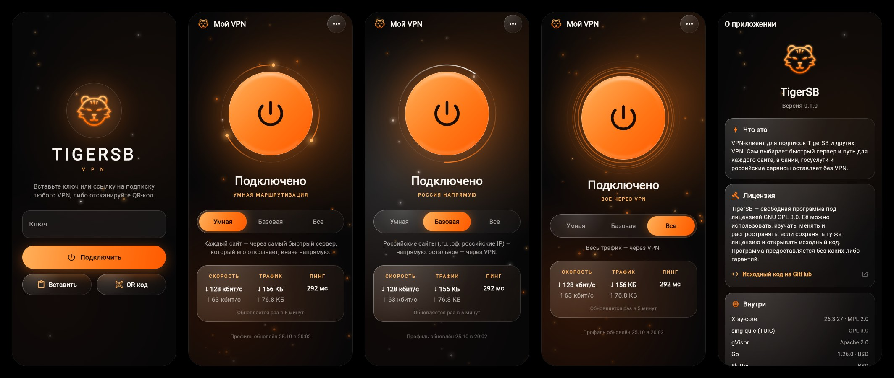

<p align="center">
  
</p>

<p align="center">
  <a href="https://github.com/Stilltiger45/TigerSB-client/releases/tag/V0.1"></a>
  <a href="LICENSE"></a>
  
  
</p>

<p align="center">
  <a href="https://github.com/XTLS/Xray-core"></a>
  <a href="https://github.com/SagerNet/sing-quic"></a>
  <a href="https://gvisor.dev"></a>
</p>

<p align="center">
  
  
  
  
</p>

<p align="center">
  🇷🇺 <b>Русский</b> &nbsp;|&nbsp; <a href="README.md">🇬🇧 English</a>
</p>

---

**TigerSB** — VPN-клиент на Xray: вставил ключ — и подключился. Работает со своей панелью [TigerSB-panel](https://github.com/Stilltiger45/TigerSB-panel) и с подписками других VPN (Marzban, 3x-ui, Remnawave и другие).

<p align="center">
  
</p>

## Возможности

- **Один ключ.** Вставьте ключ, отсканируйте QR или откройте ссылку `tigersb://` — VPN включится сам. Подойдёт и ссылка на подписку другого VPN: клиент выберет самый быстрый сервер из неё.
- **Три режима маршрутизации:**
  - **Умная** (по умолчанию) — каждый сайт проверяется через все серверы подписки и открывается через самый быстрый, который его пускает; если не пускает ни один, сайт идёт напрямую.
  - **Базовая** — российские сайты (.ru, .рф, российские IP), банки и госуслуги напрямую, всё остальное через VPN.
  - **Все** — весь трафик через VPN, кроме локальной сети.
- **Приложения мимо VPN.** MAX, ВК, Яндекс, банки и госприложения исключены из VPN и не видят туннель и адрес сервера. Свои приложения можно добавить в список.
- **Защита.** Подписка проверяется по подписи Ed25519 и не может быть подменена. Ключ хранится зашифрованным в Android Keystore и не попадает в резервные копии. Экран защищён от скриншотов, записи и нажатий через чужие окна.
- **Надёжное соединение.** Сторож раз в минуту проверяет туннель и перезапускает ядро, если сервер перестал отвечать. При переходе с Wi-Fi на мобильную сеть и обратно клиент переподключается сам. MTU подбирается под сеть.
- **Удобства.** Рамка со скоростью, трафиком и пингом, плитка в шторке, текущий протокол в уведомлении, автообновление профиля и списков блокировок, «Отправить журнал» в меню, экран «О приложении» с лицензиями компонентов.

## Ядра и технологии

| Компонент | Зачем | Лицензия |
|---|---|---|
| [Xray-core](https://github.com/XTLS/Xray-core) 26.3.27 | ядро VPN: VLESS (Reality, XHTTP, gRPC), VMess, Trojan, Shadowsocks, Hysteria 2; маршрутизация, балансировщик, замер задержки | MPL-2.0 |
| [sing-quic](https://github.com/SagerNet/sing-quic) из sing-box | протокол TUIC v5, встроен в Xray как обычный исходящий | GPL-3.0 |
| [gVisor](https://gvisor.dev) | сетевой стек системного VPN (TUN) | Apache-2.0 |
| [Go](https://go.dev) 1.26 и gomobile | ядро клиента, консольная утилита `tigersb-core`, библиотека для Android | BSD-3-Clause |
| [Flutter](https://flutter.dev) 3.47 и Dart | интерфейс приложения | BSD-3-Clause |
| [Kotlin](https://kotlinlang.org) 2.4 | системный VPN Android (VpnService), слежение за сетью, Keystore | Apache-2.0 |

Поддерживаемые ссылки: `tigersb://`, `https://` (подписка), `vless://`, `vmess://`, `trojan://`, `ss://`, `hysteria2://` (`hy2://`), `tuic://`.

## Установка на Android

Скачайте `TigerSB-android.apk` со страницы [Releases](https://github.com/Stilltiger45/TigerSB-client/releases), откройте файл на телефоне и разрешите установку. Нужен Android 7 или новее. Для старых 32-битных телефонов есть `TigerSB-android-old-phones.apk`.

Приложение для Windows появится следующим этапом поверх того же ядра.

Как выпустить новую версию: [docs/releases.md](docs/releases.md).

## Как работает маршрутизация

Умная маршрутизация работает с любой подпиской, своей и чужой: например, российский сайт, который не пускает зарубежные IP, сам пойдёт через сервер в РФ или каскад. Подробно — в [docs/profile.md](docs/profile.md#режим-auto-проверка-каждого-сайта).

Ядро умеет и режим по спискам из профиля TigerSB (`main`, в консольной утилите), который разводит трафик на три направления:

- **Заблокированные сайты** идут через VPN с выходом за границей.
- **Всё остальное** идёт через VPN с выходом в РФ: провайдер и публичный Wi-Fi не видят трафик, а сайты видят российский IP.
- **Банки, госуслуги и сайты вузов** открываются напрямую: многие из них плохо работают с любым VPN.

## Консольная утилита

```bash
go build -o tigersb-core ./cmd/tigersb-core

./tigersb-core import 'tigersb://add?url=...&pk=...'   # или https://…, vless://…, hysteria2://…, tuic://…
./tigersb-core run                                     # SOCKS5 127.0.0.1:10808, HTTP 127.0.0.1:10809
```

После этого браузер или система настраиваются на прокси `127.0.0.1:10808` (SOCKS5) или `127.0.0.1:10809` (HTTP).

| Команда | Что делает |
|---|---|
| `tigersb-core import <ключ>` | добавить ключ и скачать профиль |
| `tigersb-core update` | обновить профиль по подписке |
| `tigersb-core show` | показать выходы, транспорты и размер списков |
| `tigersb-core run [-mode auto\|main\|all\|off]` | запустить VPN с локальными портами SOCKS и HTTP |
| `tigersb-core config [-mode …]` | напечатать конфиг Xray, который будет запущен |
| `tigersb-core keygen` | создать ключи подписи профиля (для панели) |
| `tigersb-core sign -key … -in …` | подписать профиль |
| `tigersb-core link -url … -pk …` | собрать ключ `tigersb://` |

Режимы: `auto` — проверка каждого сайта через все серверы (по умолчанию), `basic` — российские сайты, банки и вузы напрямую, остальное через VPN, `main` — три направления по спискам, `all` — всё через VPN, `off` — без VPN.

Если профиль использует `geosite:` или `geoip:`, `run` сам скачивает `geosite.dat` и `geoip.dat` в каталог состояния и оставляет в них только нужные списки. Свой каталог с файлами можно указать через `-assets`.

Состояние (ключ и последний профиль) хранится в `%AppData%\TigerSB` на Windows и `~/.config/TigerSB` на Linux, файл доступен только пользователю.

## Формат профиля и ключа

Описан в [docs/profile.md](docs/profile.md). Профиль подписывается Ed25519, клиент принимает только подпись закреплённым ключом.

## Разработка

```bash
go test ./...
CGO_ENABLED=0 go build -o tigersb-core ./cmd/tigersb-core
```

Тесты собирают конфиги для всех режимов и проверяют, что их принимает настоящий Xray-core.

Android-приложение лежит в `app/` (Flutter, системный VPN на Kotlin в `app/android/app/src/main/kotlin`). Ядро для него собирается из пакета `mobile/` через gomobile:

```bash
scripts/build-core-android.sh        # нужны Android SDK и NDK
cd app && flutter build apk --split-per-abi
```

Обычно это делать не нужно: GitHub Actions собирает APK на каждый pull request (вкладка Actions, артефакт `TigerSB-android`) и выкладывает релиз по тегу.

## Лицензия

GPL-3.0, см. [LICENSE](LICENSE). Клиент TUIC взят из sing-box (библиотека sing-quic), которая распространяется под GPL-3.0, поэтому и весь клиент открыт под этой лицензией.

Сторонние Go-библиотеки и их лицензии перечислены в [THIRD_PARTY_NOTICES.md](THIRD_PARTY_NOTICES.md), полные тексты видны в приложении: «О приложении» → «Лицензии компонентов». Серверная часть, [TigerSB-panel](https://github.com/Stilltiger45/TigerSB-panel), тоже под GPL-3.0.
